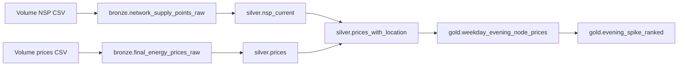
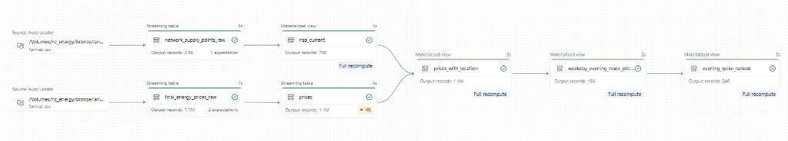
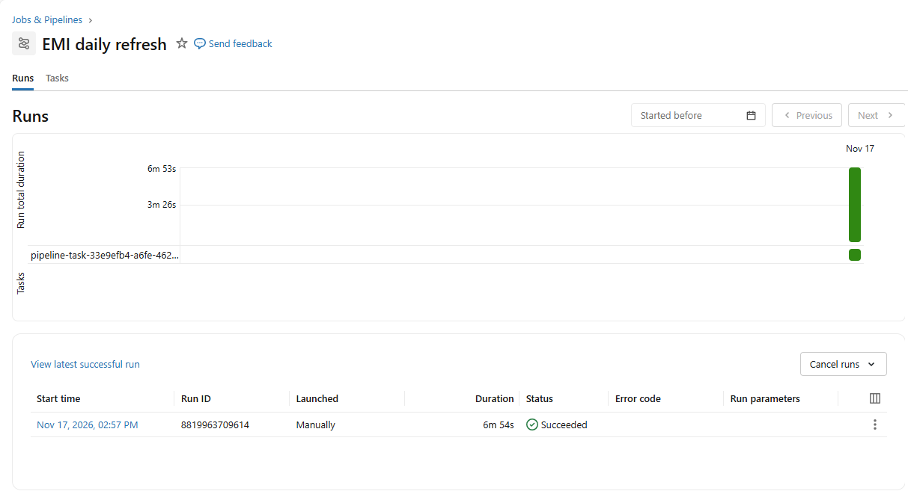
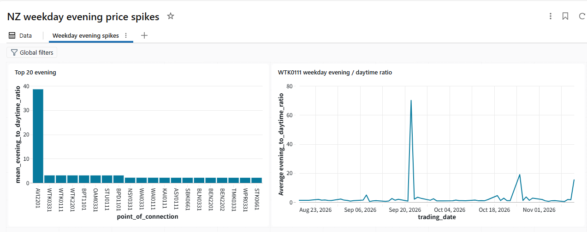

# nz-energy-lakehouse

[English](#english) | [中文](#中文)

Personal Databricks data-engineering project: New Zealand wholesale electricity prices, landed on a laptop, stored as Delta in Unity Catalog, and shaped through a Bronze / Silver / Gold pipeline.

**Status:** local EMI lander works (`src/land/download_emi.py`). One Lakeflow pipeline in `src/pipeline/` has been run (Bronze / Silver / Gold). Lakeflow Job `EMI daily refresh` triggers that pipeline on a daily Auckland schedule. An AI/BI dashboard reads the Gold tables. A Declarative Automation Bundle (`databricks.yml`) describes that pipeline and Job for `databricks bundle validate`; it is not auto-deployed. CSV cache stays in `data/landing/` and is gitignored.

---

## English

### Question

On weekdays, which grid nodes spike in **final energy price** after 17:00 NZ time?

v1 uses half-hour **FinalEnergyPrices** (last 90 daily files) plus the **NetworkSupplyPoints** dimension. Generation mix is out of scope until a later slice.

### Data

| Dataset | Grain | v1 window |
| --- | --- | --- |
| [Final energy prices](https://www.ea.govt.nz/data-and-insights/datasets/wholesale/dispatch-and-pricing/final-energy-prices/) | node × trading period × day | last 90 daily CSVs (~300 KB each) |
| Network supply points (`MappingsAndGeospatial/NetworkSupplyPointsTable`) | point of connection | current snapshot |

Files come from the Electricity Authority EMI Azure blob (`emidatasets.blob.core.windows.net/publicdata`). Download on Windows; **do not** fetch from Databricks Free Edition compute (outbound access is allowlisted). Upload into a Unity Catalog Volume, then run the pipeline.

Interim price files (`*_I.csv`) are replaced by finals; the lander must prefer the final file for a given day.

Data licence: [CC BY 4.0](https://creativecommons.org/licenses/by/4.0/). Attribution: *www.emi.ea.govt.nz provided by the Electricity Authority (New Zealand)*.

Raw CSVs are not committed. See `data/landing/` (gitignored contents).

### Layout

```text
Windows lander  →  UC Volume  →  nz_energy.bronze
                              →  nz_energy.silver   (types, expectations)
                              →  nz_energy.gold     (weekday evening-peak KPIs)
                              →  AI/BI dashboard
Lakeflow Job `EMI daily refresh`  (daily 07:00 Pacific/Auckland; does not fetch EMI)
```

Lakeflow graph after the first workspace run (Auto Loader CSV sources, then streaming tables and materialized views):



Workspace DAG after the first successful run:



Lakeflow Job `EMI daily refresh` wraps that pipeline (one pipeline task). It is scheduled daily at 07:00 `Pacific/Auckland`. The screenshot is a manual run that succeeded; Databricks compute still does not fetch EMI, and Volume upload stays manual.



AI/BI page `Weekday evening spikes`: top 20 nodes by mean evening/daytime ratio, plus the daily series for `WTK0111`. A few extreme days lift the window mean; typical days sit much lower.



| Path | Role |
| --- | --- |
| `src/land/` | Local EMI download (`download_emi.py`). Volume upload is still manual. |
| `src/pipeline/` | Lakeflow / Spark Declarative Pipelines SQL (`01_bronze.sql` → `03_gold.sql`). Workspace run notes: `src/pipeline/README.md`. |
| `databricks.yml` | Bundle identity and the single `workspace` target. Host/token stay in the local CLI profile. |
| `resources/` | Pipeline and Job YAML (`emi_lakeflow.pipeline.yml`, `emi_daily_refresh.job.yml`). |
| `docs/` | Pipeline DAG, Job run, and AI/BI dashboard screenshots |
| `data/landing/` | Local CSV cache (ignored) |

Catalog/schema names above are the public contract. A personal workspace catalog belongs in untracked `AGENTS.local.md`.

v1 Gold grain: weekday date × node, evening mean (TradingPeriod ≥ 35, 17:00 NZ) versus daytime mean (TP 15–34). Ranked node table is `nz_energy.gold.evening_spike_ranked`. The dashboard uses that rank plus the daily series for a Waitaki node (`WTK0111`).

### Development

From the repo root, `databricks bundle validate` checks the bundle against the local CLI profile. Do **not** `databricks bundle deploy` unless those YAML resources are bound to the existing workspace pipeline and Job. An unbound deploy can create a second ETL pipeline. Databricks compute still does not fetch EMI.

Code and docs in this repository are written in Cursor. Design choices, data-quality rules, and any published insights are reviewed before they count as the project’s conclusions. Git commits are authored by the repository owner; they are not machine-attributed.

This repo is original portfolio work. It is not a copy of Databricks Academy notebooks.

### Licence

- Repository code: [MIT](LICENSE)
- EMI datasets: CC BY 4.0, Electricity Authority (New Zealand)

---

## 中文

个人 Databricks 数据工程项目：新西兰电力批发市场结算电价。CSV 在本机落地，写入 Unity Catalog 的 Delta 表，再走 Bronze / Silver / Gold。

**当前状态：** 本机 EMI 下载脚本已可跑（`src/land/download_emi.py`）。`src/pipeline/` 里那条 Lakeflow 已跑通（Bronze / Silver / Gold）。Lakeflow Job `EMI daily refresh` 按奥克兰时间每天触发这条 pipeline。AI/BI 看板读 Gold 表。根目录 `databricks.yml` 用 Declarative Automation Bundles 描述这条 pipeline 和 Job，供 `databricks bundle validate`；不会一 push 就部署。CSV 缓存在 `data/landing/`，不进 git。

### 问题

工作日、新西兰时间 **17:00 之后**，哪些节点的 **final energy price** 出现尖峰？

v1 使用半小时粒度的 **FinalEnergyPrices**（最近 90 个日文件）和 **NetworkSupplyPoints** 维度表。发电结构留到后续切片。

### 数据

| 数据集 | 粒度 | v1 窗口 |
| --- | --- | --- |
| [Final energy prices](https://www.ea.govt.nz/data-and-insights/datasets/wholesale/dispatch-and-pricing/final-energy-prices/) | 节点 × 交易时段 × 日 | 最近 90 个日 CSV（每个约 300 KB） |
| 供电点表（`MappingsAndGeospatial/NetworkSupplyPointsTable`） | 并网点 | 当前一份快照 |

文件来自 Electricity Authority EMI 的 Azure blob。在 Windows 上下载；**不要**从 Databricks Free Edition 计算里直接拉网（出网有白名单）。上传到 Unity Catalog Volume 后再跑流水线。

带 `_I` 后缀的是 interim 价，定稿后会被 final 文件替换；lander 同一天只保留 final。

数据许可：[CC BY 4.0](https://creativecommons.org/licenses/by/4.0/)。署名：*www.emi.ea.govt.nz provided by the Electricity Authority (New Zealand)*。

原始 CSV 不进 git，见 `data/landing/`（内容已忽略）。

### 流向

```text
本机 lander  →  UC Volume  →  nz_energy.bronze
                           →  nz_energy.silver   （类型、质量期望）
                           →  nz_energy.gold     （工作日晚高峰 KPI）
                           →  AI/BI 看板
Lakeflow Job `EMI daily refresh`  （每天 07:00 Pacific/Auckland；不拉 EMI）
```

第一次 workspace 跑通后的 Lakeflow 图（Auto Loader 读 CSV，再接 streaming table 与 materialized view）：


第一次成功跑通后的 workspace DAG：


Lakeflow Job `EMI daily refresh` 包着这条 pipeline（一个 pipeline task），按 `Pacific/Auckland` 每天 07:00 触发。截图是一次手动 Run 成功；计算端仍不拉 EMI，Volume 上传仍是人工。


AI/BI 页面 `Weekday evening spikes`：按晚间/日间均价比的前 20 名，以及 `WTK0111` 的按日序列。窗口均值会被少数极端日抬高，多数日子低得多。


公开约定的 catalog / schema 是 `nz_energy.bronze|silver|gold`。个人 workspace 里带邮箱前缀的 catalog 只写未跟踪的 `AGENTS.local.md`。流水线 SQL 与在 workspace 里怎么建，见 `src/pipeline/README.md`。Bundle 合同在根 `databricks.yml` 和 `resources/`。

v1 Gold 粒度：工作日日期 × 节点；晚间均价（TradingPeriod ≥ 35，17:00）对比日间均价（TP 15–34）。排序表是 `nz_energy.gold.evening_spike_ranked`。看板用这张排名，外加 Waitaki 节点 `WTK0111` 的按日序列。

### 开发说明

在仓库根目录跑 `databricks bundle validate`，用本机 CLI profile，不要把 workspace URL 写进 git。**不要** `databricks bundle deploy`，除非 YAML 已经 bind 到现有的 pipeline 和 Job；未 bind 就部署可能另起一条 ETL pipeline。计算端仍不拉 EMI。

本仓库的代码与文档在 Cursor 中编写。架构取舍、数据质量规则、以及对外写出的结论，须经本人核对后才算数。Git 提交作者是仓库所有者，不使用 Cursor 的 commit / PR 署名。

这是原创作品集项目，不是 Databricks Academy 课程副本。

### 许可

- 本仓库代码：[MIT](LICENSE)
- EMI 数据集：CC BY 4.0，Electricity Authority（新西兰）
